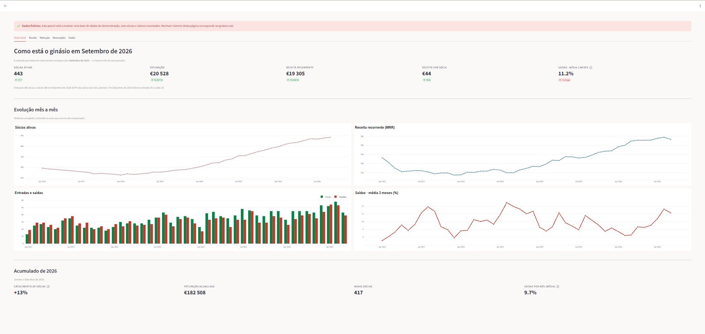

# Painel de gestão para um ginásio

Pipeline de dados e painel analítico construídos para a gerência de um ginásio
feminino na região de Lisboa. O objectivo é responder a perguntas que o software
de gestão do ginásio não responde: quantas sócias temos de facto, quanto vale a
receita recorrente, quem está prestes a desistir, e quem é preciso contactar esta
semana.



> **Os dados neste repositório são inteiramente fictícios.** O painel arranca
> sobre uma base de dados gerada por `scripts/gerar_dados_demo.py`, com sócias,
> pagamentos e presenças inventados — incluindo a própria trajectória de
> crescimento. Nenhum registo do cliente real está aqui, nem no histórico deste
> repositório — só alguns totais agregados, citados no texto para explicar as
> decisões.

## O problema

O software de gestão do ginásio mostra o estado **actual** e pouco mais. Não
guarda histórico utilizável, não calcula churn, e a única forma de tirar dados é
uma exportação manual para Excel. A gerente sabia quantas sócias tinha hoje, mas
não sabia se estava a crescer, quanto perdia por mês, nem quem estava a afastar-se
antes de a desistência acontecer.

O que faltava não era um gráfico — era uma **base de dados que acumulasse**, para
que cada exportação somasse ao que já se sabia em vez de substituir.

## As decisões que interessam

As decisões de arquitectura estão documentadas em [`docs/adr/`](docs/adr/), com o
contexto e as alternativas rejeitadas. As três que mais moldaram o resto:

**A base de dados acumula, a fonte não.** Cada exportação é uma fotografia
completa do estado da fonte naquele dia. Guardá-las lado a lado desperdiça
espaço e não resolve nada; substituir perde histórico. A base acumula como
*event-log*: pagamentos entram por `UPSERT` (a fonte reescreve linhas quando
anula um pagamento), presenças por `INSERT OR IGNORE` (um acesso nunca muda).
Ver [ADR 0002](docs/adr/0002-modelo-unificado-event-log.md).

**A janela da exportação pode ser curta, e isso é demonstrável.** Exportar 15
anos de histórico demora 20 minutos nas máquinas do ginásio e não é sustentável
de repetir. Medindo o intervalo entre pagamento e anulação em todas as anulações
do histórico, o atraso máximo alguma vez observado foram 114 dias — logo uma
janela de 6 meses apanha 100% das alterações retroactivas. Ver
[ADR 0004](docs/adr/0004-baseline-e-cobertura-temporal.md).

**A comparação é sempre homóloga, nunca com o mês anterior.** Um ginásio é
sazonal: Janeiro enche, Agosto esvazia. Comparar Abril com Março dava "+1 sócia"
e não dizia nada; comparar com Abril do ano anterior dava "+132" e dizia tudo.

**O que conta como "sócia activa" foi a parte difícil.** Não é quem pagou
mensalidade — é quem tem um serviço recorrente activo, o que inclui personal
training, aulas para crianças, e certas combinações de avaliação e nutrição. E
são duas perguntas diferentes: quem foi sócia durante um mês passado (a partir
dos pagamentos, em [`src/kpis.py`](src/kpis.py)) e quem é sócia agora (a partir
do estado lido no dia da exportação, em [`src/socias.py`](src/socias.py)). As
duas discordam de propósito, e ambas estão certas.

## Trinta dias sem aparecer

A lista de sócias em risco começou com níveis definidos por hipótese — 14, 30 e
60 dias sem aparecer. Antes de a entregar, mediu-se nos dados reais o que
acontecia a cada grupo no mês seguinte (Fevereiro a Junho de 2026, 1.827
observações sócia-mês, só sócias com mensalidade presencial):

| Dias sem aparecer | Deixam de ser sócias no mês seguinte |
|---|---|
| menos de 14 | 1,1% |
| 14 a 29 | 7,3% |
| 30 a 59 | 29,7% |
| 60 ou mais | 30,6% |
| nenhuma presença no período | 21,1% |

A taxa de base é 8,0%. O nível dos 14 dias não era sinal (fica abaixo da média),
e quem estava marcada como "perdida" aos 60 dias continuava a pagar em 7 de cada
10 casos. Ficou um corte só, aos 30 dias: 83% das saídas do mês seguinte já
estavam nessa lista. Estes números vêm dos dados reais, que não estão neste
repositório.

## Dois erros que valeu a pena apanhar

**O estado da sócia contaminava o passado.** A exportação traz o estado de cada
sócia (`utente_status`) repetido em todas as linhas de pagamento dela — mas esse
estado reflecte o **momento da exportação**, não o momento do pagamento. Uma
sócia que cancelou ontem aparece como cancelada em pagamentos de 2019.

Sem tratamento, a segunda exportação reescreveria silenciosamente o passado e a
definição de "sócia activa" apodrecia sem dar erro. É a pior classe de defeito:
não estoira, só produz números errados com ar de certos. A solução foi separar os
campos que descrevem o **evento** (imutáveis, auditados em `_log_alteracoes`) dos
que descrevem a **sócia** (seguem sempre a exportação mais recente).

**O fim do ficheiro parecia uma renovação em massa.** A lista de renovações
conta sócias cujo bloco pré-pago acaba num dado mês, e o fim do bloco é o último
mês de serviço que cada uma pagou. Para quem paga ao mês, isso é sempre o último
mês que a exportação cobre — portanto toda a gente activa caía lá: 345 num mês
contra 33 no anterior. Não era uma renovação em massa, era o horizonte dos dados.
O indicador passou a vir vazio nesse mês, em vez de mostrar um número errado.

## Como está

**Em produção desde Outubro de 2026.** O painel está instalado no computador da
gerente (macOS) e corre sobre os dados reais: cerca de 100 mil linhas de
pagamento desde 2011 e as presenças de 2026. Uma exportação nova entra largando o
ficheiro numa pasta — o painel reconhece o relatório pelas colunas, recusa o
relatório errado com a razão por escrito, e faz cópia de segurança da base antes
de lhe tocar.

Em aberto: a gerente está a rever as definições dos indicadores, e dois
indicadores (ticket médio e recompra) esperam que ela escolha a definição.

## Como correr

Precisa de Python 3.11 ou mais recente.

```bash
python -m venv .venv
.venv\Scripts\activate            # Windows
source .venv/bin/activate         # macOS / Linux
pip install -r requirements.txt

streamlit run src/dashboard.py    # o painel
python -m pytest                  # os testes
```

Arranca sobre `data/ginasio_demo.sqlite`, que já vem no repositório. Para
regenerar os dados fictícios:

```bash
python scripts/gerar_dados_demo.py --destino data/ginasio_demo.sqlite --forcar
```

Por omissão os dados acabam no fim do último mês completo, para a demonstração
não envelhecer. A semente é fixa, portanto duas execuções com o mesmo fim dão
exactamente a mesma base.

## Estrutura

```
src/
  entrada.py           Ingestão por pasta: reconhece, valida, arquiva, faz cópia de segurança
  ingestion.py         Leitura dos ficheiros exportados, com detecção de formato
  clean.py             Limpeza estrutural
  db.py                Schema (event-log + auditoria)
  ingest_pagamentos.py UPSERT com log de alterações
  ingest_presencas.py  INSERT OR IGNORE por chave natural
  repository.py        Leitura da base para pandas
  kpis.py              Indicadores mensais, a partir dos pagamentos
  socias.py            Quem é sócia agora
  historico.py         Tabela mês a mês
  receita.py           Faturação por área e por plano
  renovacoes.py        Listas de contacto accionáveis
  presencas_kpis.py    Sócias em risco, a partir das presenças
  dashboard.py         Painel Streamlit
  visual.py            Paleta e gráficos partilhados
docs/adr/              Decisões de arquitectura, com alternativas rejeitadas
docs/dicionario-dados.md   O que cada coluna da fonte significa
tests/                 Testes (pytest)
```

## Stack

Python · pandas · SQLite · Streamlit · Plotly · pytest

## Nota sobre método

Escrevi este projecto com assistência de IA como par de programação, o que me
permitiu avançar mais depressa do que o meu nível actual de código sozinho
permitiria. O que é meu, e o que defendo em qualquer conversa: o problema, o
modelo de dados, a definição de cada indicador, e as decisões documentadas nas
ADRs. Duas delas vieram de eu contestar o que o código fazia na altura: o
tratamento do estado da sócia (o primeiro erro acima) e a comparação sempre
homóloga.
